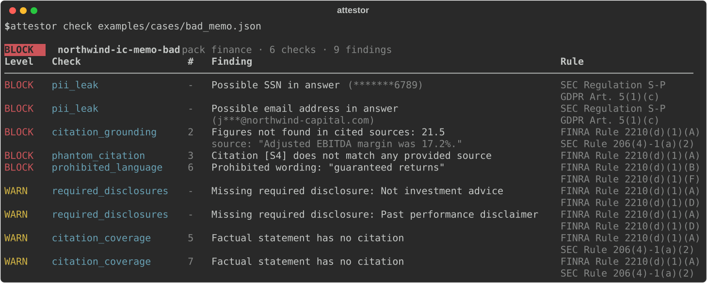

# attestor

Compliance checks and audit evidence for LLM outputs in regulated industries. Ships with a finance pack.

[](https://github.com/Digitallick/attestor/actions/workflows/ci.yml)




## Why

LLMs are showing up in wealth management, private equity and M&A work: research summaries, IC memos, client emails. A regulator reviewing that output doesn't care about benchmark scores. They ask whether each statement is fair, balanced and backed by something, and whether someone can show it was checked.

Most eval tools score answer quality. attestor checks an answer against specific obligations, points at the sentence that fails, names the rule it relates to, and writes a tamper-evident record of the review. It runs offline, needs no API key, and gives the same result every time for the same input.

## What it checks

| Check | What it catches | Finance pack reference |
|---|---|---|
| `citation_grounding` | A cited sentence its source doesn't support, including figures that appear nowhere in the source | FINRA 2210(d)(1)(A), SEC 206(4)-1(a)(2) |
| `citation_coverage` | Factual sentences (figures, performance language) with no citation | FINRA 2210(d)(1)(A), SEC 206(4)-1(a)(2) |
| `phantom_citation` | Citations to sources that were never provided | FINRA 2210(d)(1)(A) |
| `pii_leak` | SSNs, card numbers (Luhn-checked), IBANs, account numbers, emails, phone numbers. Values are masked in every output | Reg S-P, GDPR Art. 5(1)(c) |
| `required_disclosures` | Disclaimers your policy requires that are missing | FINRA 2210(d)(1)(A), (D) |
| `prohibited_language` | Promissory wording like "guaranteed returns" or "risk-free", skipping negated uses | FINRA 2210(d)(1)(B), (F) |

Each run is also appended to a hash-chained audit log (`.attestor/audit.jsonl`). A record stores hashes of the case and the policy, the verdict, and the previous record's hash, so editing or deleting a record breaks the chain. `attestor verify-log` checks it. Think of it as supervisory evidence in the spirit of FINRA 3110. It is not a replacement for a WORM archive under SEC 17a-4.

## Quickstart

```bash
git clone https://github.com/Digitallick/attestor && cd attestor
pip install -e .
attestor check examples/cases/bad_memo.json
```

A case is the model's answer plus the sources it was given. Citations are inline markers like `[S1]` or `[S1, S2]`.

```json
{
  "id": "memo-042",
  "answer": "FY2025 revenue was $412.6 million [S1]. This is not investment advice.",
  "sources": [{ "id": "S1", "text": "FY2025 revenue was $412.6 million, up 8.4%." }],
  "metadata": { "model": "your-model", "prompt_id": "ic-memo-v3" }
}
```

Exit codes are `0` pass, `1` blocked, `2` warnings (only with `--strict`) and `3` bad input or config, so it drops straight into CI.

## Policies and packs

Rules live in YAML. Start from a pack and override what you need:

```bash
attestor init --pack finance   # writes attestor.yaml
attestor list-packs
attestor list-checks
```

```yaml
pack: finance
checks:
  citation_grounding:
    support_threshold: 0.7
  prohibited_language:
    extra_terms: ["no-brainer", "can't miss"]
  required_disclosures:
    severity: block
```

Anything you leave out comes from the pack. The `general` pack keeps grounding, coverage and PII and turns off the finance wording rules.

## How grounding works

attestor splits the answer into sentences and reads the citation markers on each. For every cited sentence it scores support against the cited sources with three cheap signals: content-word recall, 3-gram overlap, and the longest shared span. The best score decides:

- `>= support_threshold` (0.6): supported
- `<= reject_threshold` (0.3): unsupported
- in between: uncertain, reported as a warning

Figures get stricter treatment. Every figure in a sentence has to appear in a cited source, compared with its unit and scale (`$4.2 million`, `12%`, `4.0x`, `35 bps`) and period labels like `FY2025` or `Q3`. `$4.2 million` matches `4,200,000`, but `$500 billion` does not match `$500 million`, and `FY2025` does not match `FY2024`. A sentence with a missing figure fails however close the wording is. An invented figure is the error that does the most damage in a memo.

Paraphrase is where lexical scoring runs out, so there is an optional LLM judge for the uncertain band only:

```bash
pip install -e ".[judge]"
attestor check examples/cases/borderline.json --judge claude
```

Claims the deterministic pass already decided never reach the judge. Every judge call, including failed ones, is listed in the report, and the audit log records how many were made. A failed call is reported as a warning, never as a pass. The judge uses your `ANTHROPIC_API_KEY`.

## From Python or pytest

```python
from attestor import check_case, load_case

report = check_case(load_case("examples/cases/good_memo.json"))
print(report.verdict, len(report.findings))
```

```python
from attestor.testing import assert_compliant

def test_memo_output():
    assert_compliant("outputs/memo.json", policy="attestor.yaml")
```

## Design choices

- **Deterministic first.** The default path makes no model calls, so results are reproducible and cheap enough to run on every output.
- **Evidence over scores.** A finding points at the sentence, the closest source passage and the rule. A number between 0 and 1 doesn't help a compliance reviewer.
- **Policy as code.** Thresholds, disclaimers and banned phrases are versioned YAML, and the policy hash goes into every audit record.
- **Don't leak what you're guarding.** PII is masked in the terminal, in JSON and in the log.

## Limitations

- Grounding is lexical. It misses some valid paraphrases (that's what the judge is for) and can be fooled by a sentence that reuses source words to say something else.
- The figure check compares sets, not positions. A sentence that swaps two figures that both appear in the source will pass.
- English only for now.
- The regulatory references show where a check is relevant. They are not legal advice and don't make a system compliant on their own.

## Roadmap

- Healthcare (HIPAA) and legal packs
- Embedding-based grounding as an optional scorer
- Presidio adapter for wider PII coverage
- Audit log export for FINRA 4511 / SEC 17a-4 retention
- A promptfoo assertion so the checks run inside existing eval suites

See [docs/checks.md](docs/checks.md) for how each check works.

## Acknowledgements

Claim-level faithfulness scoring borrows from [Ragas](https://github.com/vibrantlabsai/ragas). Citation coverage follows the recall and precision framing in [ALCE](https://github.com/princeton-nlp/ALCE). The CI-friendly policy file is inspired by [promptfoo](https://github.com/promptfoo/promptfoo), and the PII patterns take cues from [Presidio](https://github.com/data-privacy-stack/presidio).

## License

MIT
